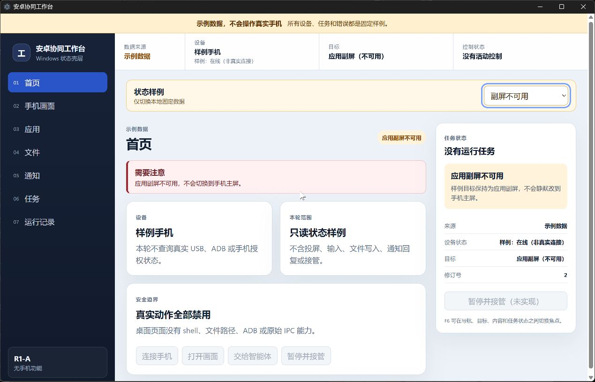

# Phone Workbench · 安卓协同工作台

**让电脑上的人和智能体，通过同一个工作台协作使用安卓手机。**

面向 **Windows 11 与现代 Android** 的开源项目，计划将手机画面、应用窗口、授权文件、通知和自动化任务汇集到桌面，并通过 MCP（模型上下文协议）向智能体提供同一套受控工具。

> **当前处于早期开发阶段（R1-A，只读骨架）。** 已有桌面演示、只读设备适配器、状态核心和两个 MCP 工具；尚未完成真实手机连接与控制的产品集成。目前没有稳定安装包，也不能用于微信回复、手机文件管理或游戏代玩。

## 当前能做什么

| 模块 | 已有实现 | 当前边界 |
| --- | --- | --- |
| 桌面界面 | Electron + React 界面，六种设备/任务状态演示 | 使用固定样例，尚未连接设备核心 |
| 设备适配 | 解析设备列表；固定 `adb devices -l` 调用、超时与取消、标识脱敏 | 默认不访问设备；仅完成模拟测试 |
| 状态核心 | 快照、刷新、并发查询合并、连接代次、失联状态处理 | 只读，不执行点击或文件修改 |
| MCP 服务 | `workbench_get_status`、`workbench_refresh_devices` | 默认未配置设备；尚未与桌面共享运行中的核心 |
| 自动化检查 | 36 项模块测试、12 项独立验收、类型检查、桌面构建 | 不代表真机功能通过 |

下图为**固定样例界面**，其中手机和任务均为演示数据：



## 想做成什么

- **看得见，也能接管：** 在电脑查看手机画面，进行键鼠操作，并随时暂停智能体、自己接手。
- **桌面与智能体共用核心：** 界面操作和 MCP 工具走同一执行入口，共享设备、目标屏幕、任务和结果状态。
- **应用副屏：** 探索在电脑打开独立的手机应用窗口，让手机主屏继续使用其他应用。需要逐机型、系统和应用验证，不能保证所有应用独立运行。
- **授权文件管理：** 浏览、搜索、传输、批量改名和文本编辑保存，覆盖用户可授权的共享文件；不承诺读取任意应用私有数据。
- **通知与条件回复：** 汇集手机通知，对支持系统回复动作的通知提供回复能力，并明确发送目标。
- **可重复的自动化：** 点击、滑动、等待、条件判断、失败停止、取消与人工接管；让智能体组合这些工具完成任务。
- **后续探索：** 剪贴板、OCR、照片归档、多设备管理与游戏操作实验。游戏自主通关属于研究目标，不作为当前能力承诺。

完整阶段与验收条件见 [路线图](docs/roadmap.md)。目前不提供 iOS 支持，也未冻结 Android 最低版本。

## 从源码运行

需要 Windows 11、Git 和 **Node.js 24.x（含 npm）**。首次启动可能下载 Electron 运行时，需能访问包源与其下载服务。

```powershell
git clone https://github.com/bugu225/phone-workbench.git
cd phone-workbench
npm ci
npm run build:desktop
npm run start:desktop -- --demo
```

不加 `--demo` 时显示“尚未连接控制服务”。以上流程不会连接或操作手机。

```powershell
npm run check:workspace
npm run typecheck
npm run test:modules
npm run test:acceptance
```

MCP 的启动与接入方式见 [开发说明](docs/development.md)。当前服务默认没有配置设备，适合研究接口和运行测试。

## 项目结构

```text
apps/desktop/            Windows 桌面界面
packages/contracts/     共享类型与状态协议
packages/device-bridge/  只读 ADB 适配器
packages/core/           状态核心
packages/mcp-server/     MCP 工具入口
tests/acceptance/        独立模拟验收
docs/                   架构、路线图与开发说明
```

安卓伴随应用、文件服务与操作任务引擎仍在规划中。详细设计见 [架构说明](docs/architecture.md)。

## 参与和许可

欢迎通过 [Issues](https://github.com/bugu225/phone-workbench/issues) 讨论场景、兼容性和缺陷，提交代码前请阅读 [贡献说明](CONTRIBUTING.md)。报告中请区分模拟结果和真机结果，并移除设备标识、聊天内容等私人信息。

原创代码采用 [MIT License](LICENSE)。第三方依赖保留各自许可证，见 [第三方说明](THIRD_PARTY_NOTICES.md)。本仓库不分发 Android DEX 的反编译代码或私有二进制，也不附带 ADB/scrcpy 可执行文件。
