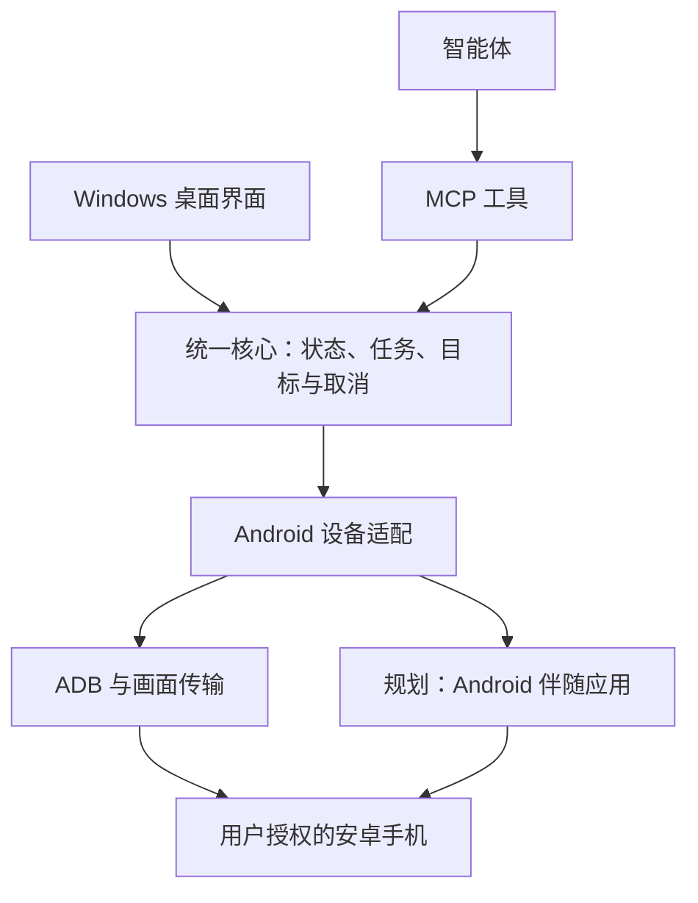

# 架构说明

Phone Workbench 将设备状态与任务执行集中在核心服务中，让桌面和智能体对同一台手机有一致的理解。下面是**目标架构**；除只读模块外，其余连线与能力仍在开发。

## 当前代码边界

- `contracts` 定义只读快照、设备能力与适配器端口。
- `device-bridge` 提供设备列表解析和受限的进程调用。调用固定为 `adb devices -l`；默认不启动进程；不提供通用 shell。
- `core` 依赖抽象设备适配器，维护状态和公共设备标识。并发刷新共用一次发现；查询失败会保留已知设备并标为过时，不伪造“设备列表为空”。
- `mcp-server` 将同一个 CoreService 实例包装成两个只读工具。默认 stdio 入口创建未配置的核心。
- `desktop` 目前是独立的状态演示界面，不通过 IPC 连接上述核心。桌面与 MCP 共用运行中的核心是下一阶段的集成目标。

## 操作设计原则

1. 每个动作携带明确的设备、会话、显示屏和画面上下文，避免过期坐标操作到另一块屏幕。
2. 按可用能力选择结构化接口、界面元素或画面识别；MCP 是工具协议，本身不获得安卓系统权限。
3. 查询、动作和结果验证分开记录。命令返回成功不代表手机已达到目标状态。
4. 副屏不可用时返回明确失败，不静默改成主屏操作；任务可取消，人工接管优先。
5. 文件和通知功能依赖用户授权与系统可用接口。共享存储、应用私有目录和通知回复是不同的权限边界。

## 已实现的保护

设备适配器使用参数数组与 `shell: false`，限定超时和输出大小。设备序列号通过本地盐值派生不透明标识，原始标识和进程错误输出不进入公共快照。

桌面使用上下文隔离、渲染沙箱和有限预加载接口，渲染页面不能直接调用系统命令。演示数据有持续标识，真实动作按钮尚未开放。

这些设计与模拟测试不构成真机兼容性结论。安卓版本、厂商限制、副屏行为与应用差异需要独立验证。
